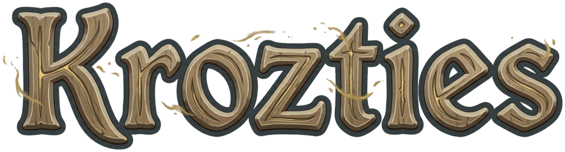

<p align="center"></p>

Krozties calcule, pour un personnage et son équipement, la rotation de sorts
qui fait le plus de dégâts sur plusieurs tours dans Dofus 3. Ses outils
(KrozTools) couvrent aussi les zones, les réseaux de pièges du Sram, les
bombes du Roublard, les portails de l'Eliotrope et la ligne de vue.

Données du jeu : version 3.7.

## Comment Krozties est fait

Chaque règle de calcul (sorts, effets, durées, cumuls, objets) a été
confrontée à la donnée du jeu, et une partie a été vérifiée en jeu. Plus de
700 tests automatisés gardent ces règles d'une version à l'autre.

## Erreurs et signalements

Malgré ces vérifications, il reste sans doute des erreurs : une rotation qui
n'est pas la meilleure, des dégâts mal calculés, un effet mal compris. Si vous
en voyez une, ou tout autre bug, ouvrez une
[issue](https://github.com/Pasouvenla/krozties/issues) en donnant la classe et
le niveau, le lien DofusBook de l'équipement, le sort ou la rotation en cause,
ce que Krozties affiche et ce que le jeu donne. Une capture du jeu aide
beaucoup.

Dans l'application, la page Retours (menu Aide) ouvre ce formulaire déjà
rempli avec la version, la classe et le niveau, le lien de l'équipement et les
réglages de la rotation : il reste à décrire le problème et à coller la
capture.

## Vie privée

Krozties n'a ni télémétrie, ni mesure d'audience, ni compte : rien ne part sur
votre utilisation. L'application ne contacte le réseau que dans quatre cas :

- **Nouvelle version** : à chaque ouverture, l'application de bureau
  demande à l'API de GitHub (`api.github.com`) le numéro de la dernière version
  publiée. GitHub voit alors votre adresse IP, comme pour toute page web. Si une
  version plus récente existe, une mini fenêtre l'annonce en bas à droite.
- **Import d'un équipement** : quand vous donnez un lien DofusBook,
  l'application ouvre la page de cet équipement dans une vue invisible pour le
  lire, comme le ferait votre navigateur, avec ce que la page de DofusBook
  charge elle-même.
- **Téléchargement** : le bouton « Télécharger » de la mini fenêtre ouvre la
  page des versions dans votre navigateur.
- **Retours** : le bouton de la page Retours ouvre dans votre navigateur le
  formulaire d'issue de GitHub, rempli avec ce que la page affiche. Rien ne
  part tant que vous ne l'envoyez pas vous-même.

Sur votre machine, Krozties garde la date de sa dernière vérification de
version et le numéro qu'il a vu, ainsi que les personnages et les builds que
vous enregistrez (l'équipement importé, son lien et sa fiche DofusBook), pour
les retrouver à l'ouverture suivante. Ils ne quittent cet ordinateur que si
vous exportez la liste dans un fichier. Un équipement importé sans être
enregistré n'est pas conservé.

## DofusBook

Krozties ne cherche pas à remplacer DofusBook : c'est toujours là qu'on monte
son stuff, et Krozties prend le relais pour les rotations. Quand vous lui donnez
le lien de votre équipement, il ouvre la page, comme vous le feriez dans votre
navigateur, et regarde ce que porte votre personnage. C'est tout : il ne lit
rien d'autre et n'envoie rien ailleurs, et ne garde l'équipement que si vous
l'enregistrez sous un personnage.

## Installation

Chaque version dépose ses paquets sur la page des
[versions](https://github.com/Pasouvenla/krozties/releases/latest).

### macOS (Apple Silicon et Intel)

Avec [Homebrew](https://brew.sh) :

```bash
brew install --cask pasouvenla/krozties/krozties
```

Sinon, [télécharger le `.dmg`](https://github.com/Pasouvenla/krozties/releases/latest/download/Krozties_universal.dmg), l'ouvrir et
glisser Krozties dans Applications.

Krozties n'est pas signé par Apple : au premier lancement, macOS refuse de
l'ouvrir. Dans Réglages Système, Confidentialité et sécurité, cliquer sur
« Ouvrir quand même », une seule fois.

### Windows

[Télécharger l'installateur](https://github.com/Pasouvenla/krozties/releases/latest/download/Krozties_x64-setup.exe) (ou le
[`.msi`](https://github.com/Pasouvenla/krozties/releases/latest/download/Krozties_x64.msi)), puis le lancer. Krozties n'est pas signé : si
SmartScreen affiche « Windows a protégé votre ordinateur », cliquer sur
« Informations complémentaires », puis sur « Exécuter quand même ».

### Linux

- [AppImage](https://github.com/Pasouvenla/krozties/releases/latest/download/Krozties_amd64.AppImage) : `chmod +x Krozties_amd64.AppImage`,
  puis la lancer.
- Debian, Ubuntu ([`.deb`](https://github.com/Pasouvenla/krozties/releases/latest/download/Krozties_amd64.deb)) :
  `sudo apt install ./Krozties_amd64.deb`
- Fedora ([`.rpm`](https://github.com/Pasouvenla/krozties/releases/latest/download/Krozties_x86_64.rpm)) :
  `sudo dnf install ./Krozties_x86_64.rpm`

## Licence

Le code de Krozties est publié sous licence AGPL-3.0 (fichier `LICENSE`).
Les données et visuels du jeu n'en font pas partie.

## Mentions

Certaines illustrations et éléments visuels sont la propriété d'Ankama Studio
et de Dofus. Cet outil est un outil communautaire non officiel, sans
affiliation avec Ankama.
